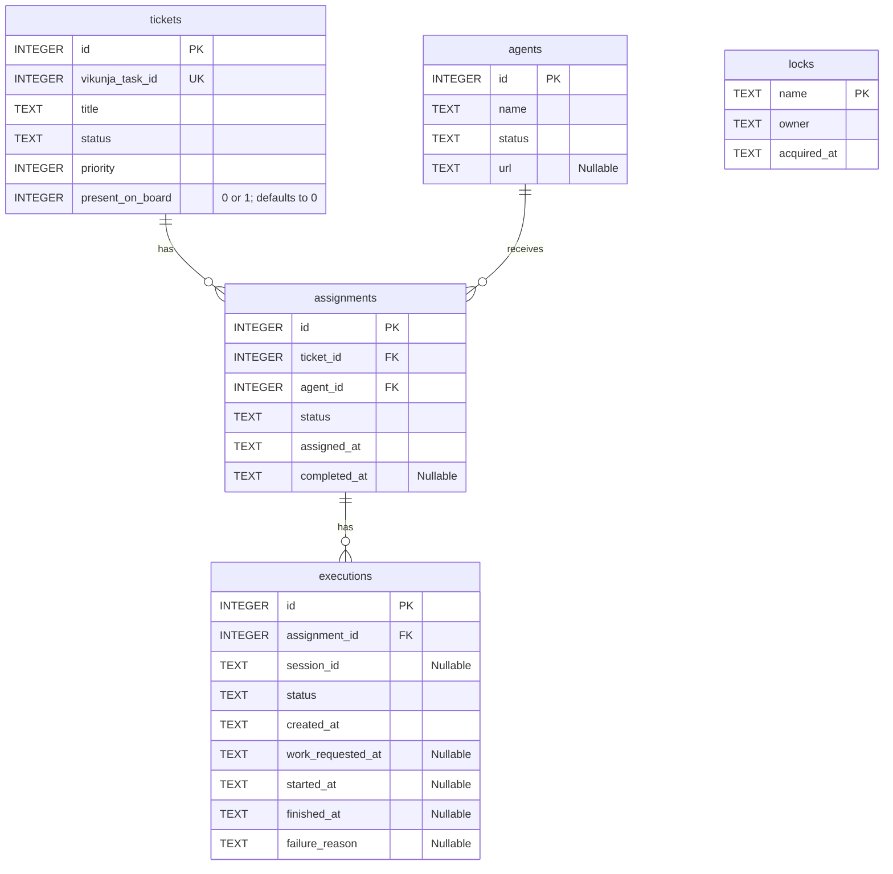

# Resource Manager data proposal

Estimated reading time: 9 minutes (150 WPM)

This is the working shared-data design. The Resource Manager has been refactored to domain collections and models; its new flow has not been verified against deployed services. The [sequence diagram](sequence-diagram.md) describes the earlier flow and may differ from current code.

## Database schema

This diagram covers all five tables in the [fresh SQLite seed](../shared-db/seed.sql). It describes the seed, not necessarily an existing database.

Each assignment references one ticket and one agent; each execution references one assignment. A ticket, agent, or assignment can have zero or more related records. `locks` is independent of the other tables. All unmarked columns are required, and all five tables are SQLite `STRICT` tables. See [setup](setup.md) for prerequisites and seed limitations.

## Executions

An execution record tracks startup and work for an assignment. The `executions` table keeps OpenCode session and attempt history for monitoring and debugging. A record does not necessarily count as an attempt; see the counting rules below. The user approved the execution and lock fields shown above.

The `locks` table coordinates the Resource Manager and Ticket Scheduler. Both claim and release the row using short database operations. Neither holds a SQLite transaction open during Vikunja calls. The manager warns when a lock is held for more than two minutes, but leaves it for human review. Recovery steps remain deferred.

### Execution statuses

The user approved these statuses:

- `starting`: preparing or requesting work; startup is not confirmed yet.
- `running`: the agent has started the work.
- `succeeded`: the agent stopped processing and is ready for another task.
- `failed`: the manager judged the attempt failed, such as when the agent times out or becomes unreachable.

### Creating an execution

Create a `starting` execution after fetching the Vikunja task successfully and before creating the OpenCode session. This records that startup began even if the manager crashes during it. Creating the record does not by itself settle whether it counts as an attempt.

Save the session ID on the execution as soon as OpenCode returns it, before logging and sending the work request. This allows the manager to find that known session after a restart.

If the session-creation response is lost before the ID is saved, retry session creation. This may leave an extra session on the agent; the Resource Manager has not sent work to that unknown session.

After a restart, if the session ID is saved but `work_requested_at` is empty, check and reuse the known session instead of automatically creating another. The missing timestamp does not prove the work request was never sent.

If that session is busy, watch it rather than immediately sending another prompt. A previously sent but unrecorded request still does not count as an attempt.

If that session is idle, resend the work request to the same session. Earlier unrecorded work may already have finished, so the user accepts that this can repeat work. Record the new request according to the attempt-counting rule.

If OpenCode reports that the saved session no longer exists and `work_requested_at` is empty, the simplified manager marks the execution `failed` and moves the ticket to `Retry` before releasing the assignment. It does not count as an attempt. An unreachable agent or an unknown session state is not the same as a confirmed missing session.

If the saved session is confirmed missing and `work_requested_at` is recorded, mark the attempt failed and move the ticket toward `Retry`. The recorded request counts toward the attempt limit. Assignment release still requires completion coordination.

If `work_requested_at` is recorded and the session is idle and ready after a restart, mark the attempt succeeded even if the manager never observed it running. The user accepts that this can miss work that had not actually started. Assignment release still requires completion coordination.

### Counting attempts

An execution counts as an attempt when the manager records `work_requested_at` in the execution table after sending the work request to OpenCode, even if the response is uncertain. Creating the execution record or failing before sending work does not by itself count.

The execution table is the source of truth for the count. If the manager sends work but crashes before recording the request, that request does not count. The user accepts that the work may be sent again after a restart.

The agreed direction is to log the execution and session IDs immediately before sending work, so a human can compare retained logs with the execution table for possible unrecorded requests. A log entry shows intent to send, not proof that the request was sent. The user wants to set logging aside for now and trusts a human to debug problems; logging implementation, retention, and monitoring details are deferred.

The assignment already links to a ticket and an agent, so their IDs need not be repeated in the execution record. The agent's URL and availability belong in the `agents` table, separate from execution history. The fresh shared seed includes the URL field; existing databases may require a schema update.

The user decided a human is responsible for prepopulating the `agents` table and ensuring its entries are valid at startup. The Resource Manager will still observe agents during operation and flag unreachable agents for human review. How the human prepares and validates the rows remains to be worked out.

## Completion coordination

The Resource Manager holds the shared lock while checking the live board for `Done` after a successful execution, or moving a failed ticket to `Retry`, and marking the assignment complete in SQLite. It does not move successful work to `Done`; an external actor does that. The Ticket Scheduler holds the same lock across its board fetch, ticket sync, and scheduling pass. This prevents an overlapping scheduler pass from using an older board fetch as the assignment is released.

Both apps use the protocol, and Vikunja reads must reflect confirmed moves. Keep the assignment reserved when safe completion cannot be established.

If the shared lock is already held, the app skips the coordinated work and retries on its next tick. The Resource Manager keeps the assignment reserved while it waits; unrelated work need not stop.

To acquire the lock, an app atomically inserts a row with the lock name and a unique owner token. The lock name is unique, so only one app can acquire it at a time. To release it, the app deletes the row only when both the name and owner token match. A potentially stale lock is left for human review, not automatically removed.

If the board check or Retry move fails or is uncertain, the Resource Manager keeps the assignment reserved, releases the lock, and retries later. A successful assignment also remains reserved if the agent is busy, unreachable, unknown, or flagged for review.

If the Retry move succeeds but marking the assignment complete fails, leave the card in its final column and retry the database completion later under the shared lock. If the database result is uncertain, inspect the assignment before retrying.

## Details to discuss

- How should the manager recover the session after a restart or an uncertain start?
- How should execution outcomes and assignment completion coordinate with the Ticket Scheduler?

**Deferred:** Logging implementation, retention, and monitoring details.

The first recorded attempt counts as 1. The Ticket Scheduler's limit defaults to 3 and is configurable. An assignment remains reserved while its `completed_at` is empty; finishing an execution does not by itself release it.
